# carsim — an analysis-first race car simulator

A Python physics simulation of a single-seater race car, built to answer one question:
**given the driver's inputs, what happens to the car, and how do conditions change it?**
Aerodynamics, tyre temperature and wear, track evolution, weather, fuel load and the racing
line are all modelled and can be switched on, changed and compared.

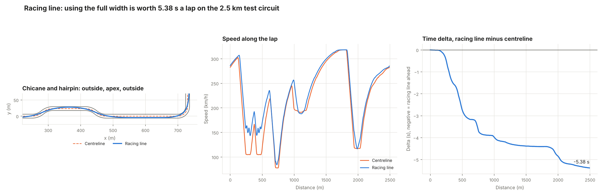

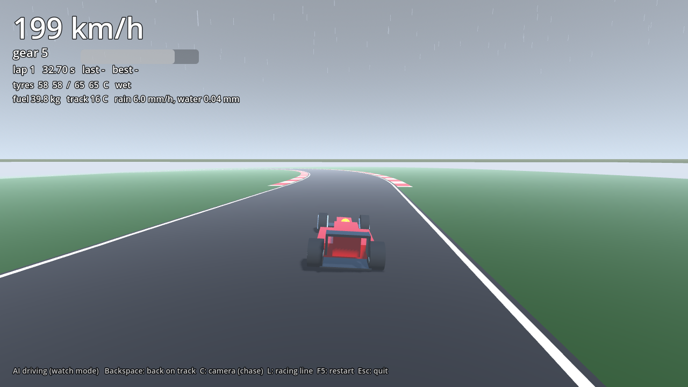

## What it simulates

| Area | What's in it |
| --- | --- |
| Powertrain | Torque curve, 8-speed gearbox, clutch slip at launch, engine braking, traction control, air-density power loss; clutch-pack limited-slip diff (preload + power/coast ramps) |
| Hybrid (ERS) | 4 MJ battery, 120 kW MGU-K deployment and braking harvest (brake-by-wire takes it off the rear discs), MGU-H exhaust recovery, ECU clipping as the battery runs low |
| Tyres | Pacejka "Magic Formula", combined slip (friction ellipse), load sensitivity, spinning wheels with lock-up and wheelspin |
| Chassis | Four-wheel planar model: steering (with Ackermann), yaw, sprung body with heave, pitch and roll |
| Suspension | Corner springs, heave (third) springs, anti-roll bars, asymmetric dampers, bump stops, four unsprung wheels on tyre springs; geometric load transfer through roll centres and anti-dive/anti-squat, elastic transfer through body roll and pitch; skid plank that bottoms out and slides; camber from static setting and roll |
| Control limits | Steering rate limit at the rack (slower at speed, as the tyres load up), throttle and brake-pressure build-up rates, tyre relaxation length (lateral force lags the slip angle), gearbox refuses over-revving downshifts. They live in the car, so every driver — you, the scripted AI and the learned AI — gets the same limits |
| Brakes | Brake bias, lock-up, rear-bias spin; carbon disc temperature per corner (little bite cold, fade above ~1000 °C, cooled through the ducts) |
| Aerodynamics | Downforce and drag vs ride height (ground effect, floor stall) and rake, loss in yaw (sliding), aero balance shift, induced drag, drag pitching moment, DRS |
| Tyre thermals | Surface and core temperature, hot pressure, wear with a cliff, grip window, water cooling |
| Track | Elevation, crests and compressions, kerbs and grass (grip and a road profile: kerb ridges with serrations, bumpy grass, asphalt waves felt through the suspension), rubbering-in, layouts from coordinates |
| Weather | Timeline of rain, air temperature, cloud and wind; track temperature; standing water, drainage, drying line |
| Wet tyres | Slick, intermediate and full wet, with their own wet grip and aquaplaning speed |
| Fuel | Burn from engine power; mass, weight split, centre of gravity and inertia change as it burns |
| Driver | Minimum-curvature racing line; AI driver that adapts to grip; keyboard/gamepad input; record and replay |
| Analysis | What-if studies, lap comparison (time delta), interactive lap viewer, reports |

## Install

    git clone https://github.com/<you>/carsim.git
    cd carsim
    pip install -e ".[dev,play]"      # numpy, scipy, matplotlib (+ pytest, pygame)

## Quick start

    python -m carsim lap --track test                        # one hot lap on the racing line
    python -m carsim stint --track test --laps 20 --fuel 60  # tyres warm, wear, fuel burns
    python -m carsim whatif --preset hot-day                 # what does +5 C do?
    python -m carsim whatif --change car.aero.ClA=*1.1 --change weather.air_temp_c=+5
    python -m carsim compare --change car.chassis.mass=+40 --name "+40 kg" --out compare.html
    python play.py                                           # drive it yourself (arrows/WASD)
    python play.py --demo --track hill --weather shower      # watch the AI in a shower

## Drive it in 3D (Godot)

The physics stays in Python; [Godot](https://godotengine.org/download) (4.3 or newer) draws the
car and the track and reads your keyboard or gamepad.

    python drive3d.py                                  # you drive: test circuit, dry
    python drive3d.py --track hill --weather shower --compound intermediate
    python drive3d.py --ai                             # watch the AI on the racing line

`drive3d.py` starts the physics server and Godot together. Put Godot on your PATH as `godot`,
or set `GODOT=/path/to/godot`. Or run the two halves yourself: `python -m carsim.server` in one
terminal, then open `godot/project.godot` in the Godot editor and press F5.

| Control | Keyboard | Gamepad |
| --- | --- | --- |
| Steer | A / D or arrows | left stick |
| Throttle / brake | W / S or arrows | right / left trigger |
| Shift up / down | E / Q | RB / LB (or A / B) |
| DRS | R | Y |
| Back on track | Backspace | Back |
| Camera: chase, cockpit, TV | C | X |
| Racing line on/off · restart · quit | L · F5 · Esc | |

| | |
| --- | --- |
| 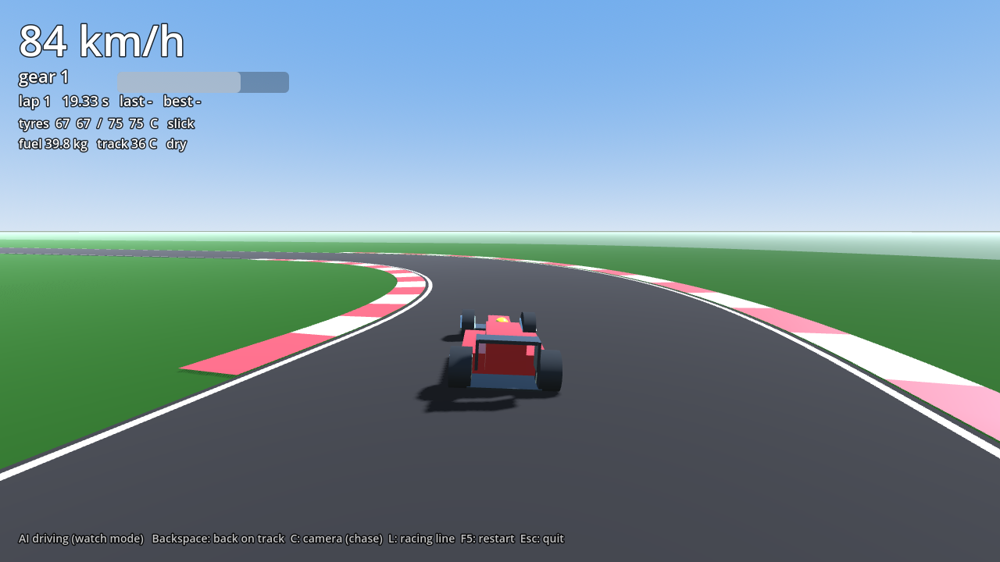 | 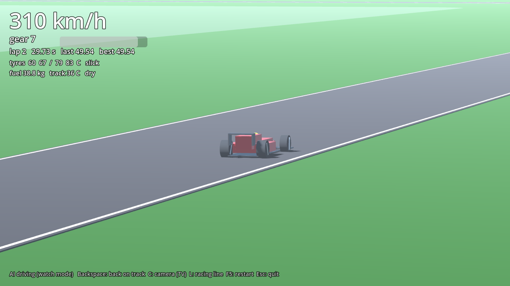 |

How it fits together: `carsim/server.py` runs the simulation at 1 kHz, paced to real time, and
streams the car's state to Godot about 60 times a second over a local TCP connection
(newline-delimited JSON); Godot sends the controls back. The track mesh, kerbs and grass are built
from the same centreline the physics uses, so hills and corners match exactly.

## An AI that teaches itself to drive

`carsim/learn.py` trains a small neural-network driver from scratch with evolution strategies
(numpy only, no deep-learning library). It sees what a driver feels and sees (speed, sliding,
position across the track, how the road curves and climbs ahead, tyre grip and temperature,
brake temperature, fuel, kerbs and grass under the wheels) and outputs a steering target and
one pedal. It starts out knowing nothing and gets better every generation: each round it tries
many slightly varied versions of itself and keeps whatever gets further without leaving the track.

It trains on **the same car you watch in 3D**: race car with fuel, tyre temperatures and wear,
carbon brakes, kerbs and grass, a rubbered racing line, and the physical control limits (it
cannot flick the steering from lock to lock, it has to wait for brake pressure to build). Each
generation it drives **three laps from the line** (laps 2 and 3 start with different momentum and
warmer tyres than lap 1), plus short practice runs from random places, speeds, tyre and brake
temperatures and fuel loads, half of them on the approach to a corner.

    python -m carsim.learn train --track short                     # uses all CPU cores; Ctrl+C any time
    nohup python -m carsim.learn train --track short --hours 12 --population 64 > train.log 2>&1 &
    python -m carsim.learn status --track short                    # progress so far
    python -m carsim.learn drive --track short                     # three laps with the best driver so far
    python drive3d.py --track short --learned                      # watch it in 3D

Training saves after every generation to `ai_runs/<track>/` and resumes where it stopped. A run
saved with older physics (before the control limits) is moved to `ai_runs/<track>/legacy_<n>/` and
training starts fresh; `--carry-over` keeps the old weights instead (inputs that existed keep their
weights, new inputs start at zero). `--laps N` changes the number of laps, `--legacy-car` trains on
the old simplified car. The 3D view reloads the newest saved driver at the end of each lap, so you
can watch it improve while it trains.

**Several tracks.** One driver can learn several circuits: practice runs are spread over the
tracks and the test drives every one of them. It is best to get it good on one track first, then
start the multi-track run from that driver:

    python -m carsim.learn train --tracks short,test,hill --init-from short --population 64
    python drive3d.py --track hill --learned --run multi_short-test-hill

Cost: the three laps plus three 500 m practice runs are about 110 s of simulated driving per
perturbation once the driver is quick; the physics runs at 1 kHz at roughly 3–4x real time per
core, so a population of 64 takes about 30–60 s a generation on 64 cores (`--workers`).

### One driver for every circuit

Trained on one track, the driver memorises that lap. Trained with `--track random`, it practises
on two brand-new random circuits every generation (`carsim/trackgen.py`: straights and corners
from 15 m hairpins to 300 m sweepers, chicanes, 2.5–6 km, 11–16 m wide, either direction), so it
has to learn to drive rather than learn a lap. Four held-out random circuits that it never trains
on pick the best driver, and Monza, which it never sees at all, is the exam:

    python -m carsim.learn train --track random --init-from short --hours 8   # head start from your short-track driver
    python analysis/learning_report.py random                                 # held-out progress + Monza
    python -m carsim.learn drive --policy random --track monza                # one lap of Monza
    python drive3d.py --track monza --learned --policy random                 # watch it in 3D

`--init-from short` copies the short-circuit driver into the new run (its two new inputs, the
distances to each track edge, start with zero weight, so it drives exactly as before on day one).
Runs from before this change keep working: the saved network's size tells which inputs it uses.

**Getting it round Monza.** The ordinary random circuits are all wider than Monza (10.6 m at
their narrowest, Monza 7.5–9.4 m), their corners are never tighter than R 15 m (Monza's first
chicane is R 9 m), and their straights are shorter (median 430 m; Monza 940 m flat out into that
chicane). A driver trained only on them weaves on Monza's narrow straight and spins. These options,
all off by default so older runs resume unchanged, close the gap without ever showing it Monza:

    python -m carsim.learn train --track random --init-from random --name monza-v2 --population 120 \
        --starts 8 --tracks-per-gen 4 --power-share 0.4 --fast-corner-share 0.25 --steer-penalty 2

| Option | What it does |
| --- | --- |
| `--power-share 0.4` | 40% of the new circuits are `power:<seed>`: Monza-like, 8–11 m wide, few corners on a 4.5–7 km lap (long straights), chicanes down to R 9 m. Adds `power:0` and `power:1` to the held-out circuits that pick the best driver |
| `--fast-corner-share 0.25` | a quarter of the random starts are at 215–315 km/h, 150–450 m before a corner at the end of a long straight: the big stop |
| `--steer-penalty 2` | practice runs lose 2 points per radian of steering travel, against the sawing at the wheel that makes it weave |
| `--starts 8 --tracks-per-gen 4` | more practice per generation: a less noisy step |
| `--name` | its own folder, `ai_runs/<name>/` |
| `--test-laps` | laps of the unseen Monza test (default: `--laps`, so 3) |

To get a Monza driver directly, fine-tune a copy on Monza itself:
`python -m carsim.learn train --track monza --init-from monza-v2 --name monza-ft --fast-corner-share 0.25 --steer-penalty 2`.
To run either on a SLURM cluster through a restricted SSH gateway, see [cluster/README.md](cluster/README.md).

**Looking further ahead, and knowing the circuit.** On top of the eight curvature points up to
230 m, the driver now has two more kinds of input (`carsim/track_memory.py`):

- *Sight*: five windows covering the next 5 seconds at its current speed (60–550 m: about 450 m
  flat out, 100 m in a hairpin). The windows get longer further out, so near the car it sees
  detail and far away only how tight the worst bit is and roughly where. Each gives the tightest
  and the mean curvature in it, so a short chicane can't hide between two points.
- *Track knowledge*: what a driver who has studied the circuit knows before seeing it: distance to
  the next two significant corners (tighter than R 100 m, a chicane counts as one), how tight they
  are, the first one's length, width and gradient, and the straight after it.

A driver trained before this starts with zero weight on the new inputs, so it drives as before
(up to floating-point rounding); train a new run from it with `--init-from`. Resuming an older run
with the new inputs archives it and starts afresh, like any change of inputs.

**Track limits, run-off and barriers.** Leaving the track no longer ends the run on the spot.
Beyond the kerbs each circuit has run-off and then a barrier (`carsim/runoff.py`; the data has no
barrier positions, so they are estimated the way circuits are laid out): walls 1.5 m beyond the
kerb on the street circuits (Monaco, Singapore, Baku, Jeddah, Las Vegas); elsewhere asphalt
outside slow corners, gravel outside medium and fast ones (low grip, heavy drag: it stops the
car) and grass along the straights and on the inside. The rules, as in F1:

- all four wheels beyond the white line (kerbs are beyond the line) is a track-limits violation:
  that lap does not count and costs a penalty
- more than 3 s off in one go: disqualified (the run ends, like a crash)
- a barrier: a crash

The driver feels how long it has been off and sees the room to the barrier on each side. This is
physics version 4: older drivers carry over with `--init-from` (`--carry-over` to resume a run).

**The 2026 car and the driver's controls.** `--car 2026` trains on a car built to the 2026 rules
(768 kg, 3.40 m wheelbase, 1.90 m wide, narrower tyres, ~400 kW engine + 350 kW MGU-K that fades out
from 290 to 355 km/h, no MGU-H, active aero; sources and estimates in
[docs/car_2026.md](docs/car_2026.md)). The driver now also controls DRS / straight mode (only opens in
the aero zones found on the long straights, closes on the brakes; Monaco has none), the brake-bias dial
(±4 %) and the ERS mode (save energy … deploy). A driver trained with only steering and pedal carries
over: its new controls start at zero, which is neutral.

**Free practice before the race.** Like FP1–FP3 at a Grand Prix, a copy of the driver can practise
on a circuit for a few generations before the 3-lap test. Nothing is saved, so this works on the
held-out F1 calendar too: it measures how quickly the driver learns a new circuit.

    python -m carsim.learn practice --policy monza-v2 --track f1:suzuka,f1:spa --generations 20

## Circuits

Use these names with `--track` anywhere:

    short, test, hill              made-up circuits (1.1 km, 2.5 km, 2.5 km with 23 m of elevation)
    monza                          Autodromo Nazionale Monza, 5.79 km, real centreline and widths
    sepang                         Sepang International Circuit, 5.54 km, real centreline and widths
    random:<seed>                  a random circuit, the same one for the same seed
    f1:<key>                       the 25 circuits of the 2026 F1 calendar (held out, see below)

Track width can vary round the lap, and differently on each side of the centreline
(`Track.width_left`, `Track.width_right`). Monza comes from the
[TUM racetrack database](https://github.com/TUMFTM/racetrack-database) (LGPL-3.0, see
`carsim/data/tracks/`): centreline from OpenStreetMap, widths between the white lines from
satellite images (about 9.4 m on average), no elevation.

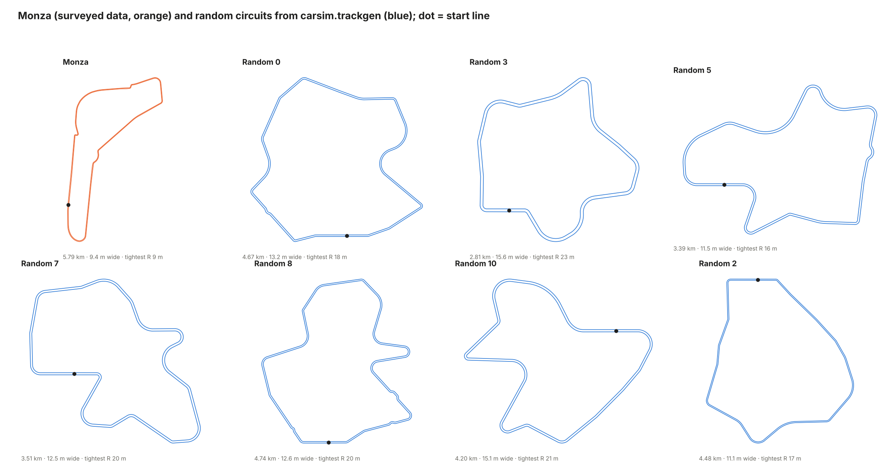

### The 2026 F1 calendar: a held-out test set

All 25 circuits of the 2026 calendar (`carsim/f1_calendar.py`, `f1:melbourne` ... `f1:yas_marina`;
Bahrain and Saudi Arabia, cancelled during the season, are kept; Sepang, which joined the calendar
in their place, is `f1:sepang`). Like Monza they are an exam,
never practice: `learn.py train` refuses them as training or validation tracks, so no driver is
ever trained on them or picked by them. Drive a trained driver round the lot (nothing is saved
into the run):

    python -m carsim.f1_calendar list                                    # rounds, lengths, widths, data source
    python -m carsim.f1_calendar drive --policy random --laps 3 --csv calendar.csv
    python -m carsim.learn drive --policy random --track f1:suzuka       # one circuit
    python analysis/calendar_report.py                                   # the maps below

12 circuits (and Monza) are the TUM survey unchanged; Melbourne, Barcelona, Zandvoort and Yas
Marina were rebuilt after the survey, so they keep it where the layout is unchanged and take the
current layout from the [f1-circuits](https://github.com/bacinger/f1-circuits) traces (MIT) where
it changed; Jeddah, Miami, Monaco, Madring, Baku, Singapore, Las Vegas and Lusail have only the
traced centreline, with a nominal 12 m width (Monaco 9 m). All are within 1 % of the official lap
length. `tools/build_f1_2026.py` rebuilds the files from pinned copies of both sources.

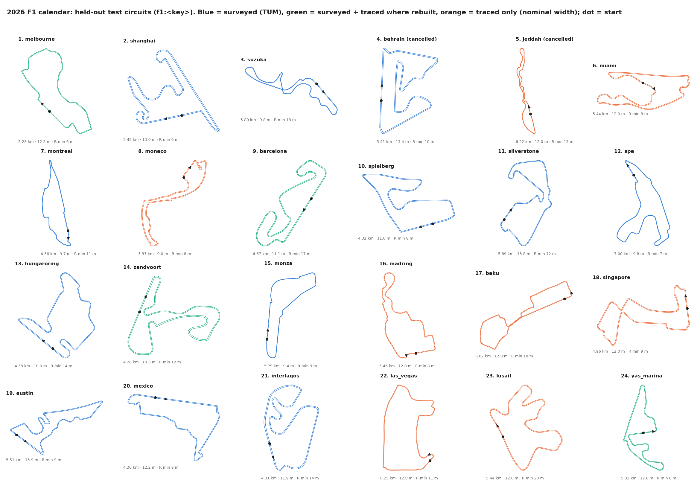

The car on real circuits is `f1_2025()`: built to the 2025 F1 rules (800 kg with driver,
3.60 m wheelbase, 2.0 m wide, 18-inch wheels), with a choice of wing (`downforce="low"` for
Monza, `"medium"`, `"high"`). `race_car()` is this car plus fuel.

`python -m carsim presets` lists the ready-made studies: hot-day, downforce, balance, weight,
tyres and track. Changes are `path=value`, `path=+delta` or `path=*factor`, where the path starts
with `car.` (any car parameter), `weather.`, `surface.` or `scenario.`.

### From Python

    from carsim import Car2D, race_car, run, run_laps
    from carsim.conditions import Conditions, Weather
    from carsim.drivers import LapDriver
    from carsim.track import hill_circuit

    tr = hill_circuit()
    cond = Conditions(tr, Weather.shower(start=120, peak=300, end=480, rain_mm_h=8), cars_on_track=20)
    car = Car2D(race_car(fuel_kg=60), conditions=cond, compound="intermediate")
    log, laps = run_laps(car, LapDriver(tr, line="racing"), 10)
    print(laps, log["tsurf_rr"][-1], log["fuel"][-1])

### Same driver inputs, different car

    from carsim.inputs import Recorder, Replay
    rec = Recorder(LapDriver(tr, line="racing"))
    base = run(car_a, rec, t_end=60)              # record what the driver does
    other = run(car_b, Replay.of(rec), t_end=60)  # replay the exact inputs on another setup

### Your own circuit

    from carsim.track import Track
    tr = Track.from_csv("my_track.csv")  # columns x, y and optionally z, width_left, width_right (m)

    from carsim.circuits import load_tum_csv   # any track from the TUM racetrack database
    tr = load_tum_csv("Spa.csv", "Spa")

    from carsim.trackgen import random_track
    tr = random_track(42, elevation=15.0)      # a random circuit with up to 15 m of elevation

## Results

What-if studies on the 1.1 km short circuit (last of three laps, 26.41 s baseline):

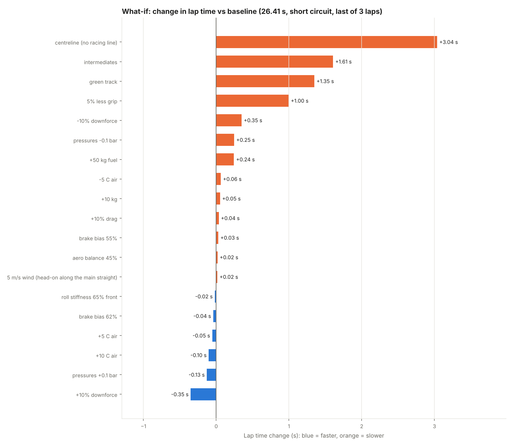

| Result | Simulated |
| --- | --- |
| 0–100 / 0–200 km/h | 2.4 s / 4.7 s |
| Top speed, DRS closed / open | 351 / 360 km/h |
| Cornering grip, R 30 m / R 220 m (no downforce) | 1.8 g / 3.2 g (1.65 g) |
| 300–0 km/h, threshold braking | 108 m |
| Tyre crossover | slick → intermediate at ~0.05 mm of water; intermediate → full wet at ~0.35 mm |
| Fuel | ~100 kg/h at full power; every 10 kg costs 0.11 s a lap (2.5 km) |
| Racing line vs centreline, 2.5 km test circuit | 42.39 s vs 47.78 s |

More reports (each made by a script in `analysis/`):

| | |
| --- | --- |
| 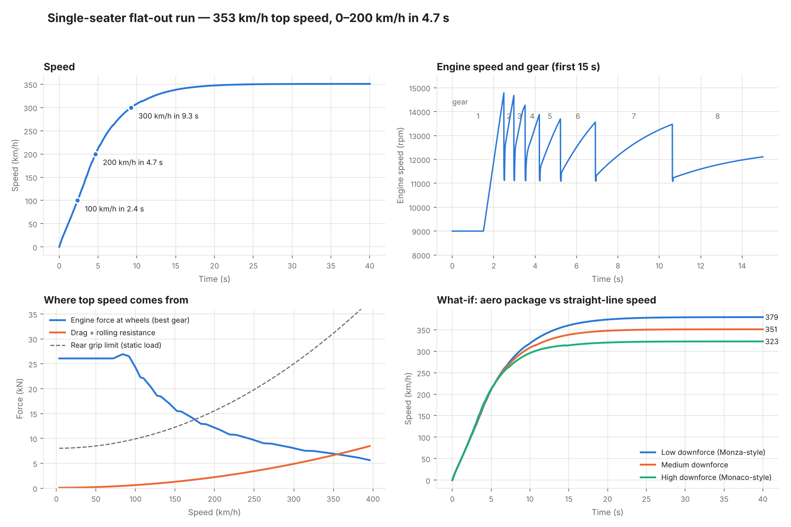 | 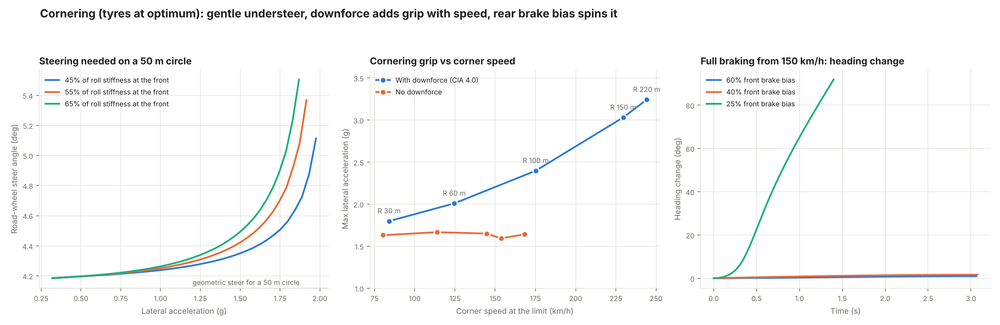 |
| 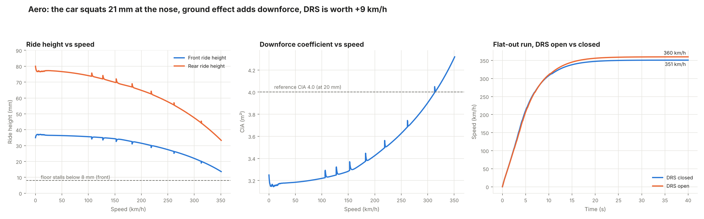 | 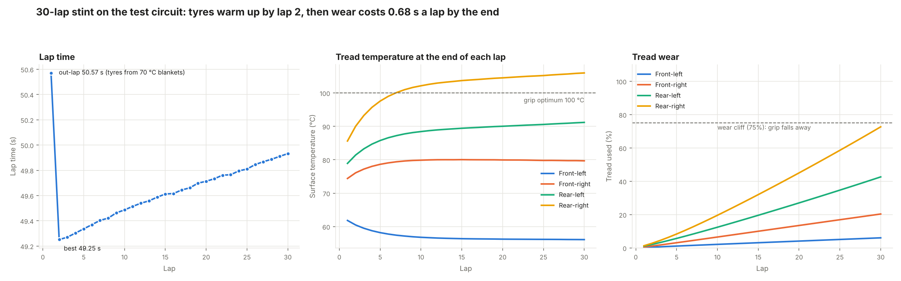 |
| 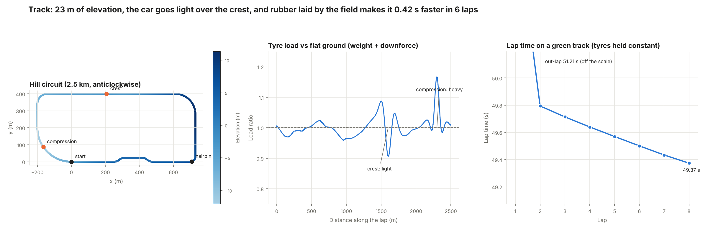 | 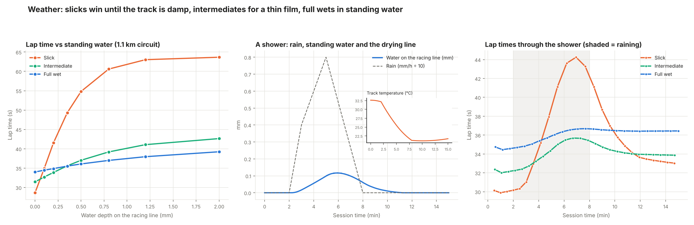 |
| 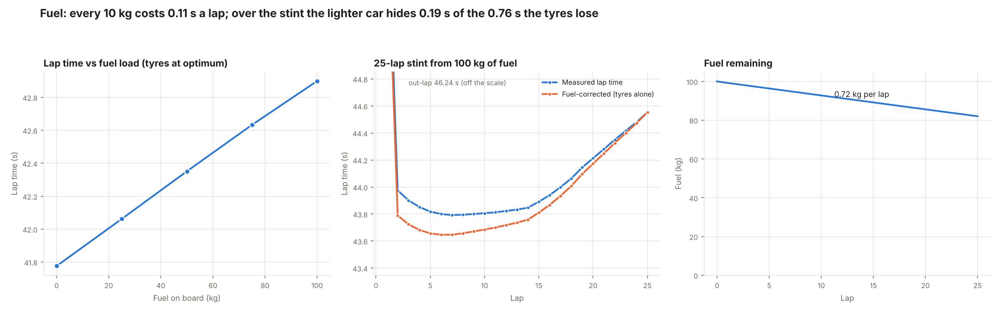 | 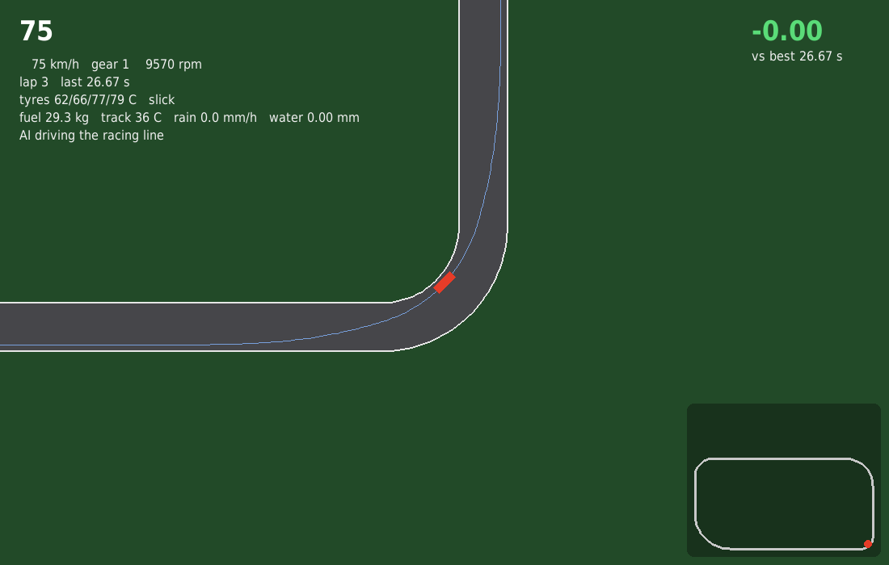 |

## Project layout

    carsim/
      params.py        car and environment parameters; f1_2025() (2025 rules), race_car()
      powertrain.py    engine, gearbox
      tyres.py         Magic Formula, combined slip, load sensitivity
      aero.py          ride-height aero map, DRS, heave ride heights
      thermal.py       tyre temperature, pressure, wear
      vehicle.py       straight-line model (phases 1–3)
      dynamics.py      four-wheel model: everything above plus track, weather and fuel
      track.py         circuits: from segments, points or CSV; elevation; varying width; surfaces
      circuits.py      every circuit by name (short, test, hill, monza, random:<seed>)
      trackgen.py      random circuit generator
      data/tracks/     surveyed circuit data (Monza)
      conditions.py    weather timeline, water, rubber, track temperature, tyre compounds
      drivers.py       scripted drivers and the AI LapDriver
      racing_line.py   minimum-curvature line
      inputs.py        HumanDriver (keyboard/gamepad), Recorder, Replay
      compare.py       lap traces, time delta, live delta
      whatif.py        what-if studies and presets
      viewer.py        interactive HTML lap viewer
      sim.py           1 kHz simulation loop; telemetry.py: per-step log
      __main__.py      command line (python -m carsim)
    carsim/learn.py    self-taught AI driver (evolution strategies), training and checkpoints
    carsim/server.py   real-time physics server for the 3D front end
    drive3d.py         starts the server and Godot together
    godot/             Godot 4 project: 3D track, car, cameras, HUD, rain (main.gd)
    play.py            real-time top-down view (pygame)
    analysis/          report scripts (PNG charts)
    tests/             132 tests, each checking a known answer (~11 min)

## Tests

    python -m pytest -q

Every phase has tests against an independent expectation: an analytic coast-down, the
power = drag top-speed balance, tyre-curve peaks, skidpad grip, spin with rear brake bias,
ride-height drop, warm-up and wear over a stint, crossover between tyre compounds, exact
input replay and more. GitHub Actions runs them on every push (`.github/workflows/tests.yml`).

## Roadmap

| Phase | Status |
| --- | --- |
| 1 Foundations · 2 Powertrain · 3 Tyres · 4 Cornering · 5 Brakes | done |
| 6 Aero and ride height · 7 Tyre temperature and wear | done |
| 8 Track evolution and elevation · 9 Weather and wet tyres | done |
| 10 Fuel and mass · 11 Racing line and live driver input | done |
| 12 What-if studies, lap viewer, playable view | done |
| 3D front end in Godot (physics in Python) | first version |
| Varying track width, random circuits, Monza, 2025-spec car, AI trained on any circuit | done |

Ideas for what's next: a better car model and sound in 3D, force feedback for steering wheels, pit stops
and race strategy, suspension pitch and roll dynamics (porpoising), a minimum-lap-time racing line,
multiple cars and slipstream.

## Known simplifications

- Parameters are generic and plausible, not taken from any real car or tyre; `f1_2025()` sizes
  the car to the 2025 rules, but its aero, tyre and power figures are estimates.
- Suspension is quasi-static load transfer with a 20 ms lag; no pitch/roll dynamics or porpoising.
- The racing line minimises curvature, a geometric approximation of the fastest line.
- The AI driver keeps a safety margin (more in the wet), so its lap times are conservative.
- Water and rubber are tracked along the lap in 5 m bins on the racing line, plus one level off the line.
- Wind blows from one direction for the whole lap (a headwind on one straight is a tailwind on the other).
- Default cars carry no fuel; `race_car()` sets the 800 kg 2025-spec car plus fuel.
- Monza is flat here (the data has no elevation) and its widths come from satellite images.
- No pit stops or tyre changes mid-run.
- The 3D car is built from simple shapes, there is no sound yet, and the body's roll is a visual
  approximation (the physics has no roll motion).

## Licence

Copyright (c) 2026 Marc Seemann. All rights reserved. This is proprietary software: you may view
it and run it for personal, non-commercial evaluation, but copying, modifying, redistributing or
commercial use needs written permission. See [LICENSE](LICENSE).
