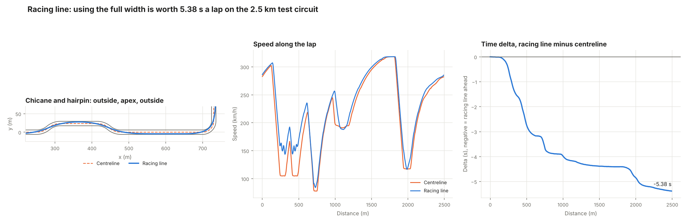
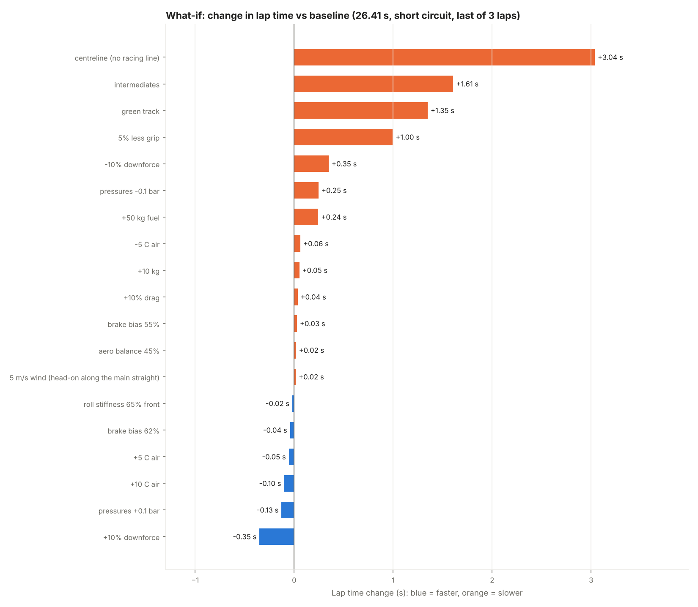
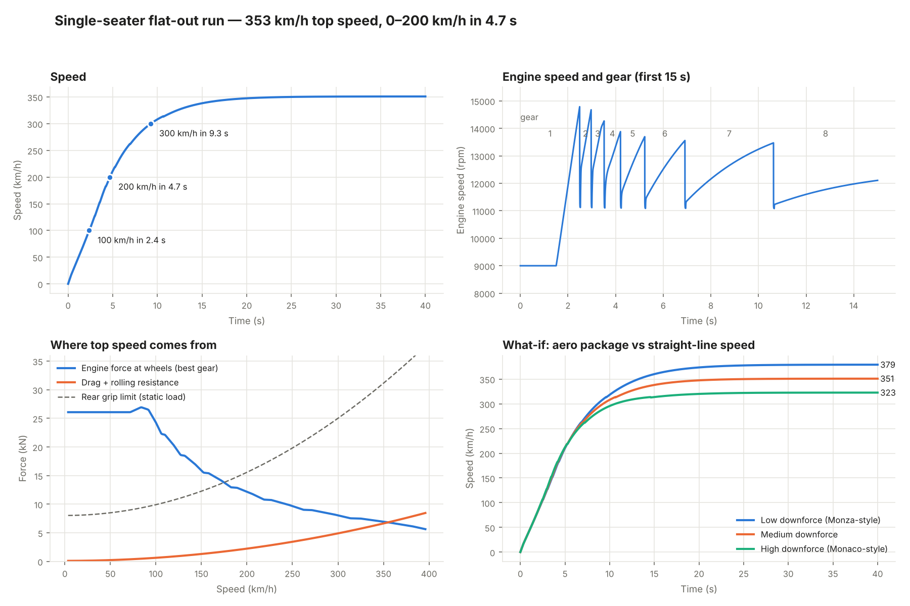
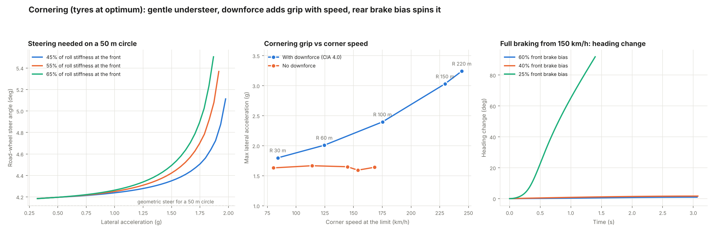
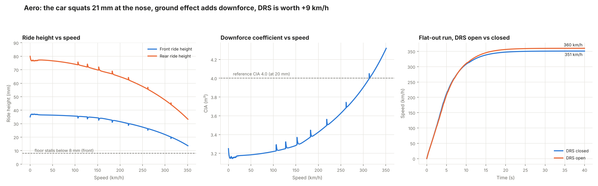
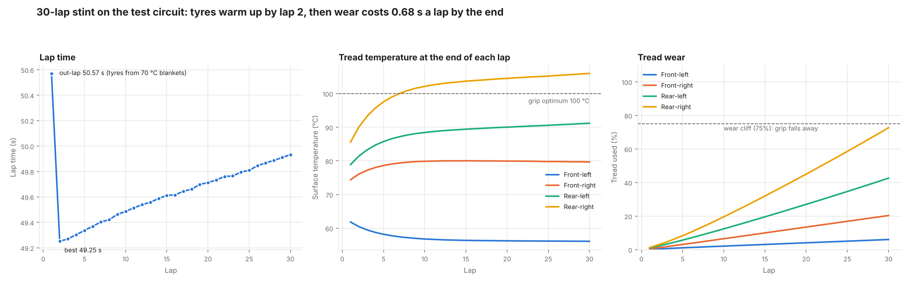
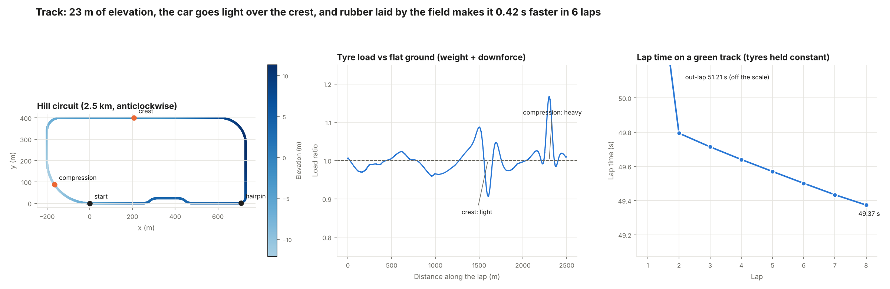
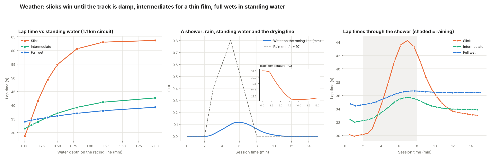
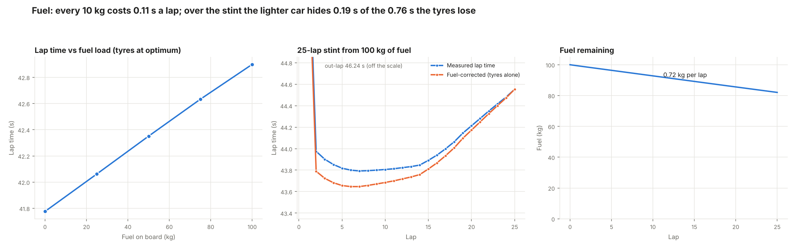
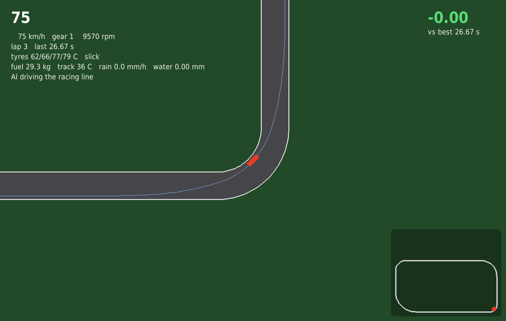

# carsim — an analysis-first race car simulator

A Python physics simulation of a single-seater race car, built to answer one question:
**given the driver's inputs, what happens to the car, and how do conditions change it?**
Aerodynamics, tyre temperature and wear, track evolution, weather, fuel load and the racing
line are all modelled and can be switched on, changed and compared.

## What it simulates

| Area | What's in it |
| --- | --- |
| Powertrain | Torque curve, 8-speed gearbox, clutch slip at launch, engine braking, traction control, air-density power loss |
| Tyres | Pacejka "Magic Formula", combined slip (friction ellipse), load sensitivity, spinning wheels with lock-up and wheelspin |
| Chassis | Four-wheel planar model: steering, yaw, longitudinal and lateral load transfer, roll-stiffness split, limited-slip diff |
| Brakes | Brake bias, lock-up, rear-bias spin |
| Aerodynamics | Downforce and drag vs ride height (ground effect, floor stall), aero balance shift, induced drag, DRS |
| Tyre thermals | Surface and core temperature, hot pressure, wear with a cliff, grip window, water cooling |
| Track | Elevation, crests and compressions, kerbs and grass, rubbering-in, layouts from coordinates |
| Weather | Timeline of rain, air temperature, cloud and wind; track temperature; standing water, drainage, drying line |
| Wet tyres | Slick, intermediate and full wet, with their own wet grip and aquaplaning speed |
| Fuel | Burn from engine power; mass, weight split, centre of gravity and inertia change as it burns |
| Driver | Minimum-curvature racing line; AI driver that adapts to grip; keyboard/gamepad input; record and replay |
| Analysis | What-if studies, lap comparison (time delta), interactive lap viewer, reports |

## Install

    git clone https://github.com/<you>/carsim.git
    cd carsim
    pip install -e ".[dev,play]"      # numpy, scipy, matplotlib (+ pytest, pygame)

## Quick start

    python -m carsim lap --track test                        # one hot lap on the racing line
    python -m carsim stint --track test --laps 20 --fuel 60  # tyres warm, wear, fuel burns
    python -m carsim whatif --preset hot-day                 # what does +5 C do?
    python -m carsim whatif --change car.aero.ClA=*1.1 --change weather.air_temp_c=+5
    python -m carsim compare --change car.chassis.mass=+40 --name "+40 kg" --out compare.html
    python play.py                                           # drive it yourself (arrows/WASD)
    python play.py --demo --track hill --weather shower      # watch the AI in a shower

`python -m carsim presets` lists the ready-made studies: hot-day, downforce, balance, weight,
tyres and track. Changes are `path=value`, `path=+delta` or `path=*factor`, where the path starts
with `car.` (any car parameter), `weather.`, `surface.` or `scenario.`.

### From Python

    from carsim import Car2D, race_car, run, run_laps
    from carsim.conditions import Conditions, Weather
    from carsim.drivers import LapDriver
    from carsim.track import hill_circuit

    tr = hill_circuit()
    cond = Conditions(tr, Weather.shower(start=120, peak=300, end=480, rain_mm_h=8), cars_on_track=20)
    car = Car2D(race_car(fuel_kg=60), conditions=cond, compound="intermediate")
    log, laps = run_laps(car, LapDriver(tr, line="racing"), 10)
    print(laps, log["tsurf_rr"][-1], log["fuel"][-1])

### Same driver inputs, different car

    from carsim.inputs import Recorder, Replay
    rec = Recorder(LapDriver(tr, line="racing"))
    base = run(car_a, rec, t_end=60)              # record what the driver does
    other = run(car_b, Replay.of(rec), t_end=60)  # replay the exact inputs on another setup

### Your own circuit

    from carsim.track import Track
    tr = Track.from_csv("my_track.csv")  # columns x, y, z in metres along the centreline

## Results

What-if studies on the 1.1 km short circuit (last of three laps, 26.41 s baseline):

| Result | Simulated |
| --- | --- |
| 0–100 / 0–200 km/h | 2.4 s / 4.7 s |
| Top speed, DRS closed / open | 351 / 360 km/h |
| Cornering grip, R 30 m / R 220 m (no downforce) | 1.8 g / 3.2 g (1.65 g) |
| 300–0 km/h, threshold braking | 108 m |
| Tyre crossover | slick → intermediate at ~0.05 mm of water; intermediate → full wet at ~0.35 mm |
| Fuel | ~100 kg/h at full power; every 10 kg costs 0.11 s a lap (2.5 km) |
| Racing line vs centreline, 2.5 km test circuit | 42.39 s vs 47.78 s |

More reports (each made by a script in `analysis/`):

| | |
| --- | --- |
|  |  |
|  |  |
|  |  |
|  |  |

## Project layout

    carsim/
      params.py        car and environment parameters (generic single-seater values); race_car()
      powertrain.py    engine, gearbox
      tyres.py         Magic Formula, combined slip, load sensitivity
      aero.py          ride-height aero map, DRS, heave ride heights
      thermal.py       tyre temperature, pressure, wear
      vehicle.py       straight-line model (phases 1–3)
      dynamics.py      four-wheel model: everything above plus track, weather and fuel
      track.py         circuits: from segments, points or CSV; elevation; surfaces
      conditions.py    weather timeline, water, rubber, track temperature, tyre compounds
      drivers.py       scripted drivers and the AI LapDriver
      racing_line.py   minimum-curvature line
      inputs.py        HumanDriver (keyboard/gamepad), Recorder, Replay
      compare.py       lap traces, time delta, live delta
      whatif.py        what-if studies and presets
      viewer.py        interactive HTML lap viewer
      sim.py           1 kHz simulation loop; telemetry.py: per-step log
      __main__.py      command line (python -m carsim)
    play.py            real-time playable view (pygame)
    analysis/          report scripts (PNG charts)
    tests/             91 tests, each checking a known answer (~8 min)

## Tests

    python -m pytest -q

Every phase has tests against an independent expectation: an analytic coast-down, the
power = drag top-speed balance, tyre-curve peaks, skidpad grip, spin with rear brake bias,
ride-height drop, warm-up and wear over a stint, crossover between tyre compounds, exact
input replay and more. GitHub Actions runs them on every push (`.github/workflows/tests.yml`).

## Roadmap

| Phase | Status |
| --- | --- |
| 1 Foundations · 2 Powertrain · 3 Tyres · 4 Cornering · 5 Brakes | done |
| 6 Aero and ride height · 7 Tyre temperature and wear | done |
| 8 Track evolution and elevation · 9 Weather and wet tyres | done |
| 10 Fuel and mass · 11 Racing line and live driver input | done |
| 12 What-if studies, lap viewer, playable view | done |

Ideas for what's next: pit stops and race strategy, suspension pitch and roll dynamics (porpoising),
a minimum-lap-time racing line, multiple cars and slipstream, a 3D view.

## Known simplifications

- Parameters are generic and plausible, not taken from any real car or tyre.
- Suspension is quasi-static load transfer with a 20 ms lag; no pitch/roll dynamics or porpoising.
- The racing line minimises curvature, a geometric approximation of the fastest line.
- The AI driver keeps a safety margin (more in the wet), so its lap times are conservative.
- Water and rubber are tracked along the lap in 5 m bins on the racing line, plus one level off the line.
- Wind blows from one direction for the whole lap (a headwind on one straight is a tailwind on the other).
- Default cars carry no fuel; `race_car()` sets a 798 kg car plus fuel.
- No pit stops or tyre changes mid-run.

## Licence

MIT — see [LICENSE](LICENSE).
